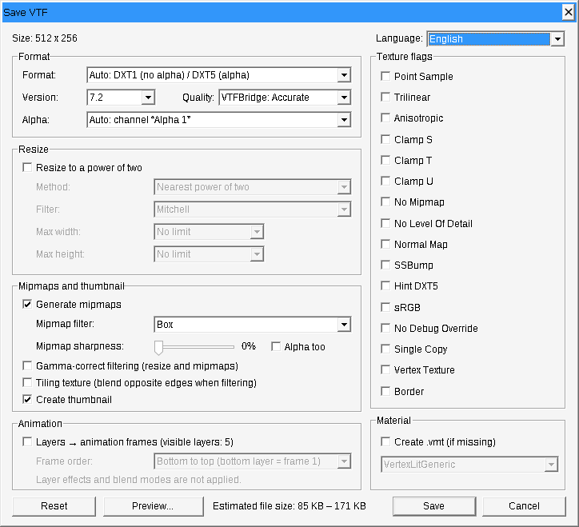
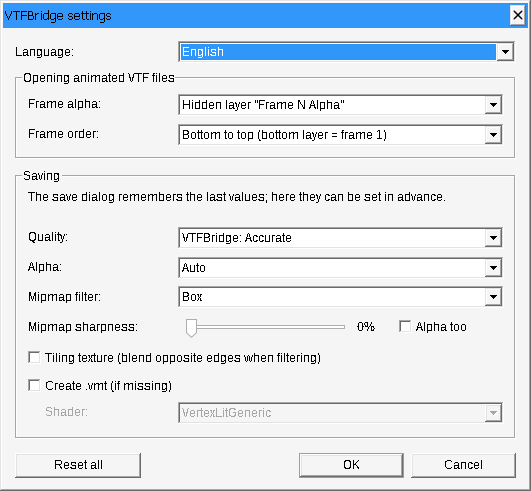
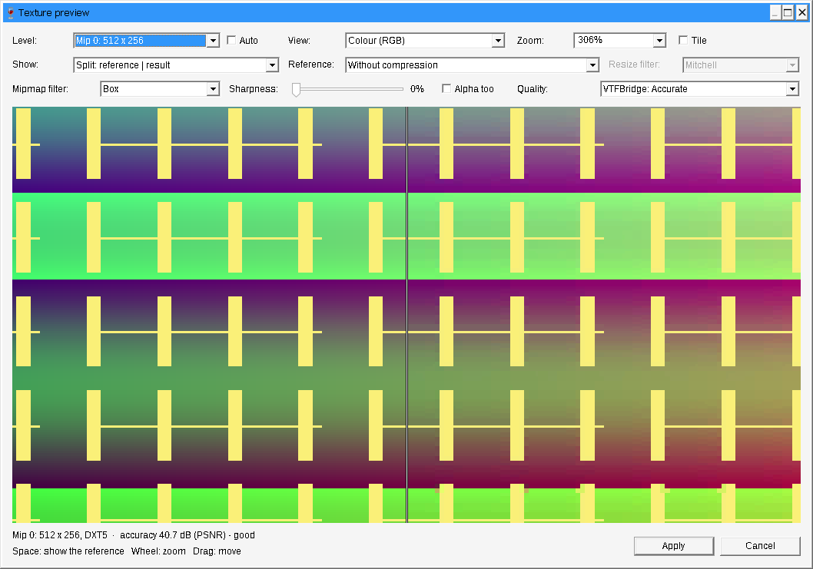
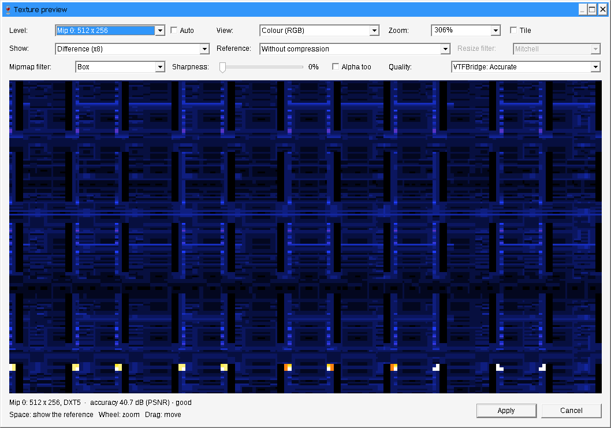
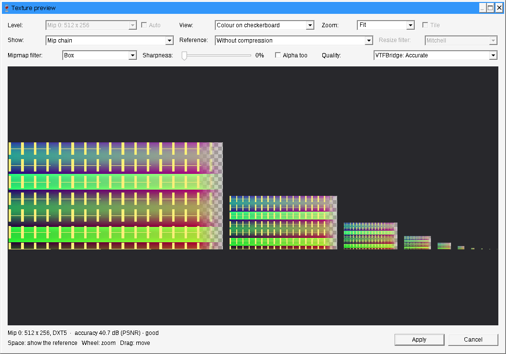
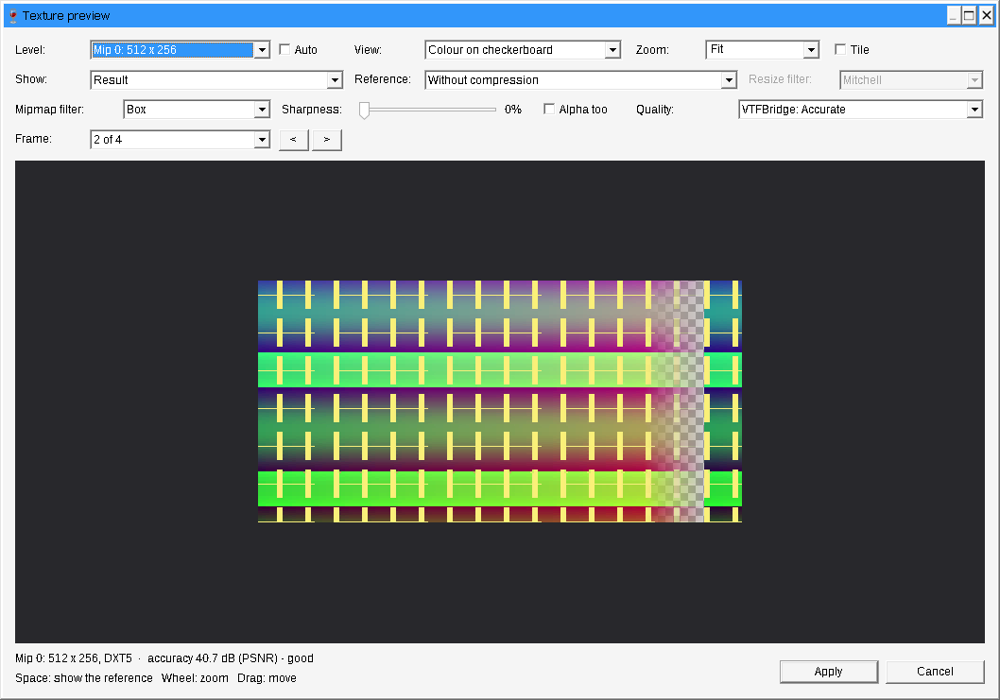
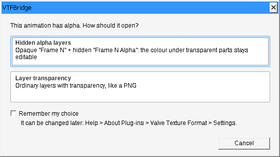

# VTFBridge — Valve Texture Format plug-in for Photoshop (x64)

[Русская версия](README.ru.md)

Open and save **Valve Texture Format (`.vtf`)** files — the texture format of the Source engine
(Half-Life 2, Counter-Strike: Source, Garry's Mod, Team Fortress 2, Portal, …) — directly in
modern 64-bit Adobe Photoshop on Windows.

It replaces the old 32-bit `VTF.8bi` plug-in, which does not load in 64-bit Photoshop.
No external DLLs: VTFLib is not needed, DXT compression is built in.

Formerly named **VTF Export** (1.0).



## Features

**Opening**
- VTF 7.0 – 7.5, almost every format: DXT1/3/5, DXT1 with 1-bit alpha, ATI1N/ATI2N, all 8-bit
  RGB(A)/BGR(A)/ABGR/ARGB/BGRX, 565/5551/4444, I8/IA88/A8, UV88/UVWQ/UVLX, bluescreen,
  HDR 16/32-bit (clamped to 0..1).
- Alpha opens as the alpha channel "Alpha 1".
- **Animated textures open as layers** ("Frame 1", "Frame 2", …).
- Cubemaps and volume textures: the first face / slice is opened (with a warning).
- Re-saving an opened VTF pre-fills its format, version, mipmaps and flags.

**Saving**
- Formats: **Auto DXT1 / DXT5** (default — DXT5 only if the image has alpha), **Auto BGR888 / BGRA8888**,
  or exactly DXT1, DXT3, DXT5, BGR888, BGRA8888, RGB888, RGBA8888, BGR565, BGRA4444, BGRA5551, I8, IA88, A8.
- **DXT quality:** VTFBridge's own *Accurate* (default) and *Perceptual* modes, plus Fast (stb_dxt) and High / Best (icbc) — see [DXT quality](#dxt-quality).
- **Alpha source:** layer transparency (like PNG), any alpha channel of the document by name, or none —
  see [Alpha](#alpha).
- VTF versions 7.1 – 7.5.
- Mipmaps with 15 filters (all VTFEdit filters + Lanczos), adjustable sharpness, optional gamma-correct filtering;
  16×16 DXT1 thumbnail like Valve's tools.
- Resize to a power of two (nearest / larger / smaller) with a filter and max width / height;
  the final size is shown in the dialog.
- Texture flags (Point Sample, Trilinear, Anisotropic, Clamp S/T/U, No Mipmap, No LOD, Normal Map,
  SSBump, sRGB, …) with a tooltip for each; one/eight-bit alpha flags are set automatically.
- **Normal maps:** with the *Normal Map* flag the mipmaps are renormalized, so the bumps do not
  flatten out in the distance.
- **Optional `.vmt`** next to the texture (see [Material](#material-vmt)).
- Estimated file size in the dialog and a **texture preview** window: every mip as saved, comparison with
  the uncompressed mips or your own image (see [Texture preview](#texture-preview)).
- **Visible layers → animation frames.**
- RGB and Grayscale documents, 8/16/32 bits per channel.
- Remembers the last used settings; a **Settings** window (*Help → About Plug-ins → Valve Texture Format → Settings…*)
  sets the language, how animations open and the saving defaults without saving a file first.

**Interface:** English, Русский, Deutsch built in; more languages can be added (see [Translations](#translations)).

## Installation

1. Download `VTFBridge-<version>.zip` from [Releases](../../releases).
2. Close Photoshop.
3. Copy `VTFBridge.8bi` into Photoshop's plug-in folder, for example
   `C:\Program Files\Adobe\Adobe Photoshop 2026\Plug-ins\` (needs administrator rights).
   Optionally copy the `VTFBridge_lang` folder next to it (only needed for your own translations).
4. Start Photoshop.

**Updating from VTF Export 1.0:** delete the old `VTFExport.8bi` from the plug-in folder (otherwise
Photoshop lists the format twice). Your settings are moved over automatically, and an existing
`VTFExport_lang` folder keeps working (you may rename it to `VTFBridge_lang`).

Requires 64-bit Photoshop for Windows (any version that loads 64-bit format plug-ins; developed
and tested with Photoshop 2026 / 27.x).

## Usage

- **Open:** *File → Open…* and pick a `.vtf`, or drag the file into Photoshop.
- **Save:** *File → Save a Copy…* (`Ctrl+Alt+S`) → **Valve Texture Format (\*.VTF)**.
  Recent Photoshop versions list third-party formats under *Save a Copy*, not *Save As*.

The options dialog appears before saving. If the size is not a power of two and resizing is off,
the plug-in warns you (Source may display such textures incorrectly) but lets you save anyway.

### Settings

*Help → About Plug-ins → Valve Texture Format → Settings…* sets the language, how animated VTF files
open and the saving defaults — without saving a file first. The save dialog remembers its last
values too; both edit the same settings.



### Which mipmap / resize filter?

| Filter | Look | Use for |
|---|---|---|
| **Box** | soft (default, like VTFEdit) | safe choice |
| **Mitchell** | balanced | general purpose, resizing |
| **Kaiser** / **Lanczos** | sharp | small details (text, grids, patterns) that must stay readable at a distance |

Gaussian and Cubic are the softest; Sinc, Catmull-Rom and the windowed sincs are sharper but may
ring slightly on high-contrast edges. *Gamma-correct filtering* keeps the brightness of fine light
or dark details in the mips; leave it off for normal maps, masks and other non-colour data.

Edges: by default the edges are clamped while resizing and filtering mipmaps, like in VTFEdit —
nothing bleeds in from the opposite edge (right for decals, sprites, UI). For textures that repeat
(walls, floors, terrain) check **Tiling texture**: the left edge is then blended with the right one
and the top with the bottom, so the mipmaps stay seamless. *Clamp S* / *Clamp T* turn this off for
their direction. The setting is remembered; it is switched off when re-saving a VTF that has both
*Clamp S* and *Clamp T*.

**Mipmap sharpness** (0–100 %, default 0) sharpens every mip after it is reduced, so small detail
stays visible at a distance. Try 20–40 % with *Box*; with sharp filters (Kaiser, Lanczos) less is
needed. By default only the colour is sharpened; tick **Alpha too** to sharpen the alpha
as well (cut-outs, fences, foliage that should not fade out in the distance). The full-size image is never changed.

### Texture preview

**Preview…** at the bottom of the save dialog shows the texture exactly as it will be saved: every mip
level is compressed and decoded back. The window can be resized or maximized.



- **Frame** (animations, with *Layers → animation frames*) — every frame as it will be saved (alpha
  layers and masks included); a VTF reference is compared frame by frame.
- **Level** — mip 0 (full size) down to 1 × 1. **Auto** picks the mip a graphics card would use at the
  current zoom, like moving away from a wall in the game.
- **Zoom** — measured against the full-size texture, so switching levels keeps the picture in place
  (smaller mips just look coarser). The mouse wheel zooms smoothly around the cursor; *Fit*, presets,
  or type a value. Drag to move.
- **View** — colour, alpha only, or colour on a checkerboard. **Tile** repeats the texture, to check
  the seams of tiling textures.
- **Show** — *Result*; *Reference*; *Split* (drag the line: reference on the left, result on the
  right); *Difference* (amplified ×8: dark = exact, blue → red → yellow → white = growing error;
  with the alpha view it compares alpha); *Mip chain* — all levels side by side (hover a mip for its
  numbers). **Hold Space** to see the reference instead of the result.
- **Reference** — *Without compression* (the same mips before DXT) or **your own image**: PNG, TGA,
  JPEG, BMP, TIFF, DDS, WebP or VTF, e.g. the original texture you are recreating or translating. It does not
  follow the preview's settings: a VTF's own mips are used as stored (when the sizes match — a reference
  twice as large lines up from its mip 1); for other images, or levels the file does not have, the picture
  is scaled to the level size (Mitchell for the full size, then plain Box averaging). The list shows which.
- The line below the image gives the size, the format and the **accuracy** (PSNR in dB against the
  reference; higher is closer): ≥ 45 excellent, 38–45 good, 32–38 visible loss, below 32 heavy loss.
  These grades are a rough guide.

| Difference ×8 | Mip chain | Animation frames |
|---|---|---|
|  |  |  |
- *Resize filter* (when the image is resized), *Mipmap filter*, *Sharpness* and *Quality* can be
  changed here; **Apply** copies them to the save dialog.

### Animation

**Opening:** every frame becomes a layer. To play it in Photoshop: *Window → Timeline* →
*Create Frame Animation* → panel menu → **Make Frames From Layers**. VTF files have no frame rate;
it is set in the `.vmt` (`animatedtextureframerate` of the `AnimatedTexture` proxy).

**Frame alpha** (*Help → About Plug-ins → Valve Texture Format → Settings…*: *Hidden layer* — default, *Layer
transparency*, or *Ask every time* with a *Remember my choice* box). With hidden layers an
animation with alpha opens as an opaque layer per frame (*Frame 1*) plus a
hidden grey layer with that frame's alpha right above it (*Frame 1 Alpha*). The colour under
transparent parts stays fully editable; paint the alpha layer white (opaque) / black (transparent).
On saving, a layer named *<frame layer> Alpha* (or *Альфа*) becomes the alpha of that frame, hidden
or not, and is never a frame itself. Hide the alpha layers before *Make Frames From Layers*.
To see the transparency in Photoshop (e.g. to play the animation), run **File → Automate → VTFBridge:
Alpha Layers to Masks**: every *Frame N Alpha* layer becomes the layer mask of *Frame N* (one undo
step). Masks keep the colour under them, and saving reads them directly.
(Photoshop does not let a format plug-in create layer masks or fill alpha channels when it opens a
layered file, so separate layers are the way to keep colour and alpha apart.)



**Saving:** in the *Animation* box of the dialog:
- **Layers → animation frames** — every visible layer becomes a frame. Off by default; greyed out
  when there are fewer than two visible layers; pre-checked for documents opened from an animated
  VTF (Photoshop remembers this only while the document stays open).
- **Frame order** — bottom to top (bottom layer = frame 1, same as *Make Frames From Layers*) or
  top to bottom. Remembered. A document opened from a VTF is saved back in the order it was opened.
- Only **visible** layers are used; adjustment layers and groups are skipped — hide a layer to
  leave it out.
- Frames use the raw layer pixels: transparency × layer mask × opacity × fill (× the frame's alpha layer).
  **Layer styles, blend modes and adjustment layers are not applied** — rasterize such layers first.
- *Auto* formats look at all frames: if any frame has alpha, all frames use DXT5.

Note: Photoshop may not keep the colour of fully transparent layer pixels. If the alpha of an
animation is a mask (not transparency) and the colour under it matters, check the result.

### DXT quality

DXT stores every 4×4 block as two colours plus two in-between shades; the quality setting decides
how those colours are chosen.

| Setting | Encoder | Use |
|---|---|---|
| **Fast (stb_dxt)** | stb_dxt (as in 1.0 / 1.1) | quick tests |
| **High (icbc)** | icbc cluster fit (third party) | fast, accurate on detailed textures |
| **Best (icbc)** | icbc full cluster fit + searched DXT5 alpha (third party) | as High, better DXT5 alpha |
| **VTFBridge: Accurate** (default) | stb_dxt + VTFBridge's own endpoint refinement + searched DXT5 alpha | everything; the smoothest gradients |
| **VTFBridge: Perceptual** | Accurate, with errors weighted like the eye (green > red > blue) | colour textures; not for masks or data |

The VTFBridge modes polish the two colours of every block with a local search against the exact
palette, so the result does not depend on one GPU's rounding (measured with the D3D10, NVIDIA and AMD
decoders). On smooth gradients — skies, walls, soft shading — icbc tends to merge nearly equal colours
and leaves flat 4×4 steps; *Accurate* keeps such gradients smooth (in our gradient test the banding is
about half as strong as with *Fast* or *High*). On detailed textures all modes are close. *Perceptual* lowers
the eye-weighted error at the cost of a little plain error; normal maps always use *Accurate*.

Large images are compressed on all CPU cores. Use the [preview](#texture-preview) to compare the modes.

### Alpha

The *Alpha* list in the *Format* box chooses where the alpha comes from:

- **Layer transparency** — the checkerboard areas, like in a PNG.
- **Channel "…"** — an alpha channel from the *Channels* panel, listed by name. Use it for masks
  such as `$basealphaenvmapmask`, `$selfillum` or a phong mask, while the image itself stays opaque.
- **None** — saved without alpha (the *Auto* formats then pick DXT1 / BGR888).
- **Auto** (default) — the first alpha channel if there is one, otherwise the transparency. The list
  shows what *Auto* uses for the current document.

For animation frames, *Auto* and *Layer transparency* use each layer's own transparency; a chosen
channel is applied to every frame.

### Material (.vmt)

Check **Create .vmt (if missing)** in the *Material* box and pick a shader: `VertexLitGeneric`
(models), `LightmappedGeneric` (world brushes) or `UnlitGeneric` (sprites, UI). The plug-in then
writes `<name>.vmt` next to the saved `<name>.vtf`:

- `$basetexture` is the path after the `materials` folder
  (`…\materials\models\box\wood.vtf` → `models/box/wood`); outside a `materials` folder it is just
  the file name.
- Alpha adds `$alphatest` (only fully transparent / fully opaque pixels) or `$translucent` (soft alpha).
- Several frames add the `AnimatedTexture` proxy (10 frames per second — change it in the file).
- An existing `.vmt` is **never overwritten**, so your own edits are safe.
- Not available for normal maps and SSBump textures: they are part of another material.
- If the plug-in cannot find out where the file is saved, it shows a warning; the `.vtf` is saved anyway.

## Translations

The dialog language is chosen at the top right of the save dialog (*Auto* = Windows language).

Sources, each overriding the previous one **string by string**:
1. English — compiled in (`src/Lang.cpp`); fallback for any missing string;
2. `lang/*.lang` files of this repository — embedded into the plug-in at build time;
3. `*.lang` files in the `VTFBridge_lang` folder next to `VTFBridge.8bi` — no rebuild needed.

A file with the same `language.code` as a built-in language does not add a second entry; it only
replaces the strings it contains — handy for fixing a few strings.

**Adding a language:** start from [`lang/template.lang.txt`](lang/template.lang.txt), save it as
`lang/<code>.lang` (UTF-8), set `language.name` and `language.code`, translate, check with
`python tools/check_lang.py`, and open a pull request. Details: [CONTRIBUTING.md](CONTRIBUTING.md).

**Without rebuilding:** put the file into `VTFBridge_lang` next to the plug-in. Languages are
re-read every time the dialog opens. The folder path is shown in
*Help → About Plug-ins → Valve Texture Format*.

## Building from source

1. **Visual Studio 2022 or 2026** (Community is fine) with *Desktop development with C++*.
2. **Photoshop C++ SDK** (free, requires an Adobe ID): [Adobe Developer Console](https://developer.adobe.com/developer-console/)
   → *APIs and services* → *Photoshop Plug-In and Connection SDK* (Windows).
   The SDK may not be redistributed, so it is not part of this repository. Unpack it so that this
   file exists:
   ```
   photoshop_sdk\pluginsdk\photoshopapi\photoshop\PIFormat.h
   ```
   (or build with `msbuild VTFBridge.sln /p:PhotoshopSdkDir=D:\path\to\sdk\` — the folder that
   contains `pluginsdk`, trailing backslash required).
3. Open `VTFBridge.sln`, select **Release | x64**, build.
   Output: `bin\Release\VTFBridge.8bi` and `bin\Release\VTFBridge_lang\`.

The pre-build step embeds `lang\*.lang` with `tools\embed_lang.ps1` (PowerShell); the PiPL
resource is compiled with the SDK's `Cnvtpipl.exe`.

Release archive: `powershell -ExecutionPolicy Bypass -File tools\make_release.ps1`
→ `dist\VTFBridge-<version>.zip`. The script refuses to pack a plug-in that contains the
path of your build folder (it would reveal your user name).

### Tests

The core (encoder, decoder, filters, animation) and the plug-in itself are tested on Linux
without Photoshop or the SDK:

```sh
pip install srctools pillow
tests/run_tests.sh          # core: g++ + python
tests/run_tests.sh --wine   # + plug-in under Wine with fake Photoshop hosts (needs MinGW + Wine)
```

Independent reference: the VTF reader of [srctools](https://github.com/TeamSpen210/srctools).
The fake hosts use `tests/sdk_stub/` — a minimal stand-in for the SDK headers written for this
project; the real plug-in is always built against the real SDK.

## Project layout

```
src/            plug-in source (VtfWriter/VtfReader/Resample/Vmt are platform-independent)
lang/           translations embedded at build time (+ template.lang.txt)
tools/          embed_lang (build), check_lang (translation checker), make_release
tests/          test suite, sdk_stub for the fake hosts
third_party/    stb_dxt.h (fast DXT compressor, public domain), icbc.h (high-quality DXT1 colour encoder, MIT)
photoshop_sdk/  put the Photoshop SDK here (not in the repository)
docs/           screenshots
```

## License

[MIT](LICENSE). Third-party code: see [THIRD_PARTY_NOTICES.md](THIRD_PARTY_NOTICES.md).
Adobe and Photoshop are trademarks of Adobe; Valve and Source are trademarks of Valve Corporation.
This project is not affiliated with either.
