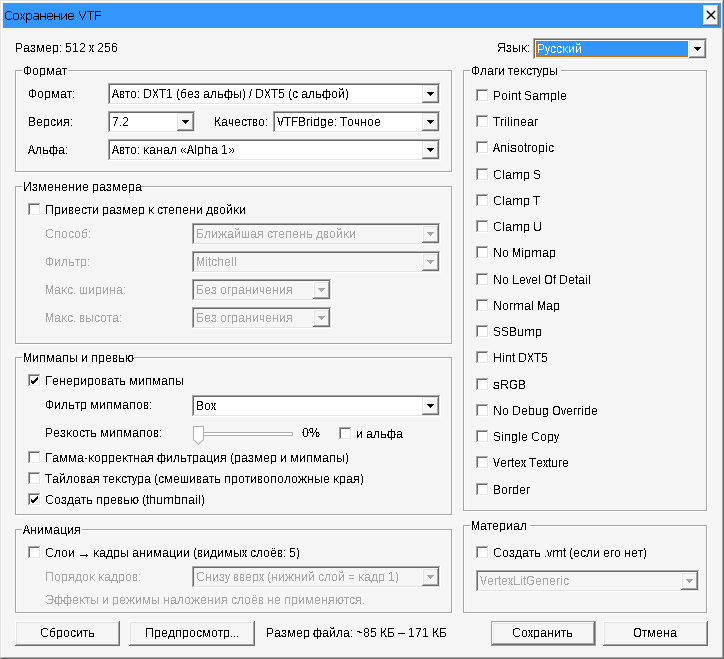
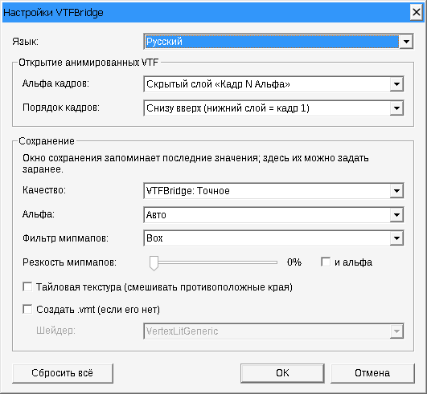
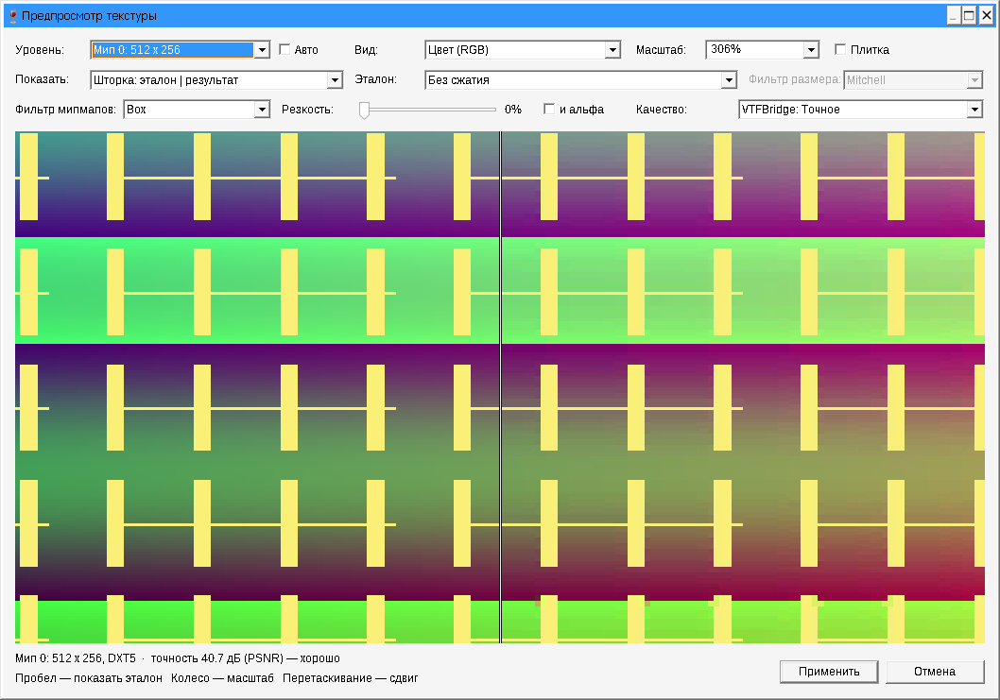
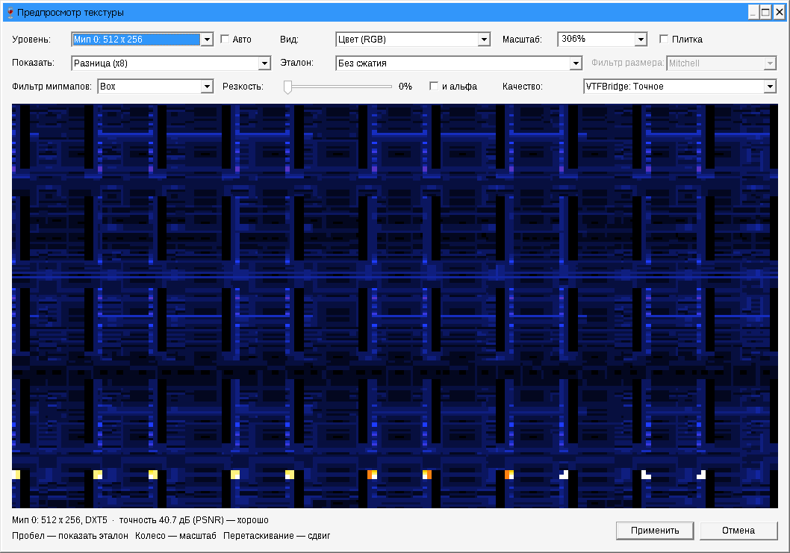
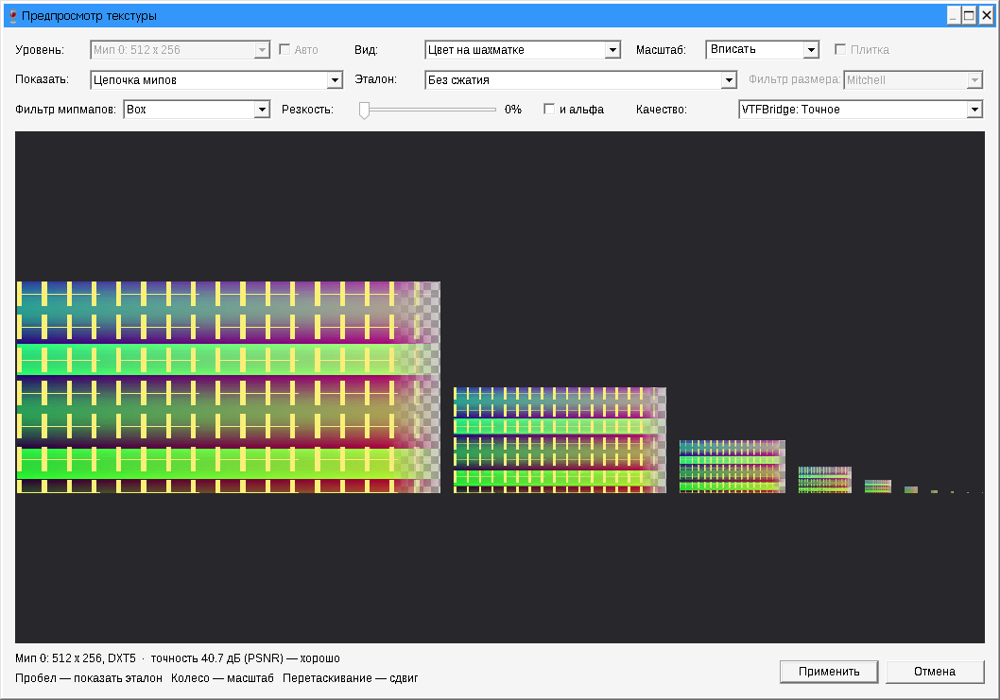
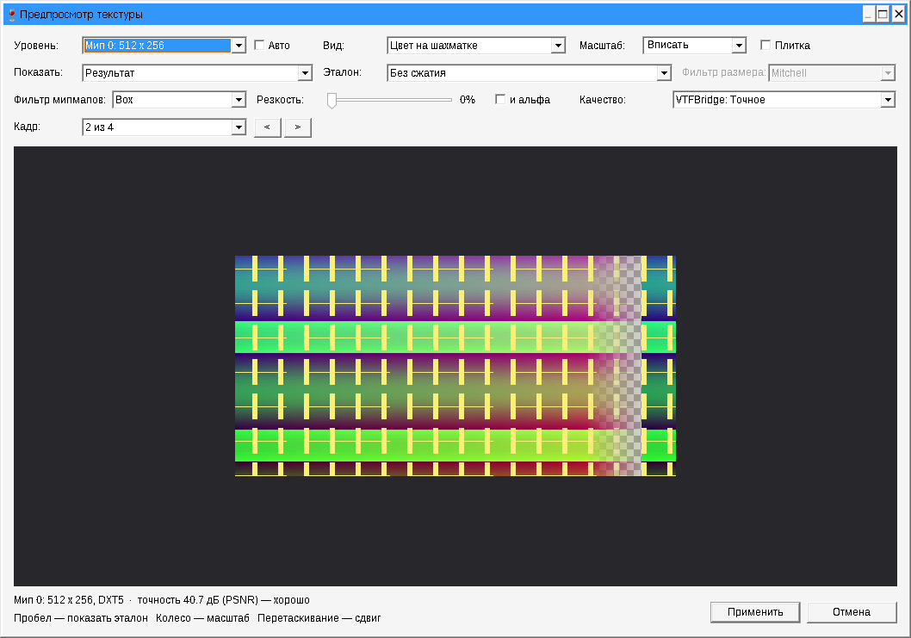
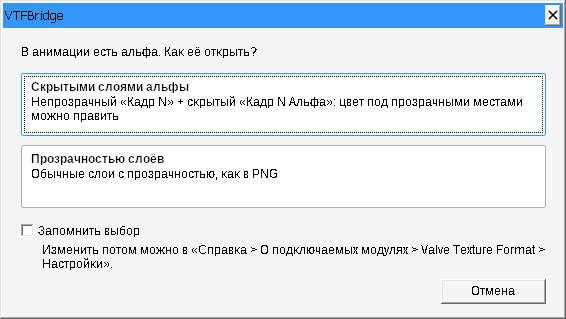

# VTFBridge — плагин Valve Texture Format для Photoshop (x64)

[English version](README.md)

Открытие и сохранение файлов **Valve Texture Format (`.vtf`)** — формата текстур движка Source
(Half-Life 2, Counter-Strike: Source, Garry's Mod, Team Fortress 2, Portal, …) — прямо в
современном 64-битном Adobe Photoshop под Windows.

Заменяет старый 32-битный плагин `VTF.8bi`, который 64-битный Photoshop не загружает.
Внешних DLL нет: VTFLib не нужен, DXT-сжатие встроено.

Раньше назывался **VTF Export** (1.0).



## Возможности

**Открытие**
- VTF 7.0 – 7.5, почти все форматы: DXT1/3/5, DXT1 с 1-битной альфой, ATI1N/ATI2N, все 8-битные
  RGB(A)/BGR(A)/ABGR/ARGB/BGRX, 565/5551/4444, I8/IA88/A8, UV88/UVWQ/UVLX, bluescreen,
  HDR 16/32 бит (обрезается до 0..1).
- Альфа открывается как альфа-канал «Alpha 1».
- **Анимированные текстуры открываются слоями** («Кадр 1», «Кадр 2», …).
- Кубмапы и объёмные текстуры: открывается первая грань / срез (с предупреждением).
- При пересохранении открытого VTF подставляются его формат, версия, мипмапы и флаги.

**Сохранение**
- Форматы: **Авто DXT1 / DXT5** (по умолчанию — DXT5, только если есть альфа),
  **Авто BGR888 / BGRA8888** или конкретно DXT1, DXT3, DXT5, BGR888, BGRA8888, RGB888, RGBA8888,
  BGR565, BGRA4444, BGRA5551, I8, IA88, A8.
- **Качество DXT:** собственные режимы VTFBridge «Точное» (по умолчанию) и «Перцептивное», а также «Быстрое» (stb_dxt) и «Высокое» / «Наилучшее» (icbc) — см. [Качество DXT](#качество-dxt).
- **Источник альфы:** прозрачность слоя (как в PNG), любой альфа-канал документа по имени или без альфы —
  см. [Альфа](#альфа).
- Версии VTF 7.1 – 7.5.
- Мипмапы с 15 фильтрами (все фильтры VTFEdit + Lanczos), настраиваемой резкостью и гамма-корректной фильтрацией по желанию;
  превью 16×16 DXT1, как у инструментов Valve.
- Приведение размера к степени двойки (ближайшая / большая / меньшая) с фильтром и ограничением
  ширины / высоты; итоговый размер виден в окне.
- Флаги текстуры (Point Sample, Trilinear, Anisotropic, Clamp S/T/U, No Mipmap, No LOD, Normal Map,
  SSBump, sRGB, …) с подсказкой к каждому; флаги 1/8-битной альфы ставятся автоматически.
- **Карты нормалей:** с флагом *Normal Map* мипмапы перенормируются, и рельеф не «выцветает» вдали.
- **Материал `.vmt` по желанию** рядом с текстурой (см. [Материал](#материал-vmt)).
- Примерный размер файла прямо в окне и окно **предпросмотра текстуры**: каждый мип как в файле, сравнение
  с мипами без сжатия или со своим изображением (см. [Предпросмотр текстуры](#предпросмотр-текстуры)).
- **Видимые слои → кадры анимации.**
- Документы RGB и Grayscale, 8/16/32 бита на канал.
- Последние настройки запоминаются; окно **«Настройки»** («Справка → О подключаемых модулях → Valve Texture Format → Настройки…»)
  задаёт язык, способ открытия анимаций и значения для сохранения без сохранения файла.

**Интерфейс:** встроены English, Русский, Deutsch; можно добавлять свои языки (см. [Переводы](#переводы)).

## Установка

1. Скачать `VTFBridge-<версия>.zip` в разделе [Releases](../../releases).
2. Закрыть Photoshop.
3. Скопировать `VTFBridge.8bi` в папку плагинов Photoshop, например
   `C:\Program Files\Adobe\Adobe Photoshop 2026\Plug-ins\` (нужны права администратора).
   Папку `VTFBridge_lang` можно положить рядом — она нужна только для своих переводов.
4. Запустить Photoshop.

**Обновление с VTF Export 1.0:** удалите старый `VTFExport.8bi` из папки плагинов (иначе формат
появится в списке дважды). Настройки перенесутся сами, а старая папка `VTFExport_lang` продолжит
работать (её можно переименовать в `VTFBridge_lang`).

Нужен 64-битный Photoshop для Windows (любая версия, загружающая 64-битные плагины форматов;
разработка и проверка — Photoshop 2026 / 27.x).

## Использование

- **Открыть:** *Файл → Открыть…*, выбрать `.vtf`, или перетащить файл в Photoshop.
- **Сохранить:** *Файл → Сохранить копию…* (`Ctrl+Alt+S`) → **Valve Texture Format (\*.VTF)**.
  В новых версиях Photoshop сторонние форматы есть в «Сохранить копию», а не в «Сохранить как».

Перед сохранением появляется окно настроек. Если размер не степень двойки, а ресайз выключен,
плагин предупредит (Source может показывать такие текстуры неправильно), но сохранить позволит.

### Настройки

«Справка → О подключаемых модулях → Valve Texture Format → Настройки…» — язык, способ открытия
анимированных VTF и значения для сохранения, без сохранения файла. Окно сохранения тоже запоминает
последние значения; оба меняют одни и те же настройки.



### Какой фильтр выбрать

| Фильтр | Характер | Когда брать |
|---|---|---|
| **Box** | мягкий (по умолчанию, как в VTFEdit) | безопасный выбор |
| **Mitchell** | сбалансированный | универсально, при изменении размера |
| **Kaiser** / **Lanczos** | резкий | мелкие детали (надписи, сетки, узоры) должны читаться издали |

Gaussian и Cubic — самые мягкие; Sinc, Catmull-Rom и оконные sinc резче, но на контрастных краях
могут давать лёгкий ореол. *Гамма-корректная фильтрация* сохраняет яркость тонких светлых и тёмных
деталей в мипах; для карт нормалей, масок и прочих «данных» её лучше не включать.

Края: по умолчанию при ресайзе и фильтрации мипмапов края не «заворачиваются», как в VTFEdit, —
ничего не просачивается с противоположного края (то, что нужно для декалей, спрайтов, интерфейса).
Для повторяющихся текстур (стены, пол, земля) включите **«Тайловая текстура»**: тогда левый край
смешивается с правым, верхний — с нижним, и мипмапы остаются бесшовными. Флаги *Clamp S* / *Clamp T*
отключают это для своего направления. Настройка запоминается; при пересохранении VTF с флагами
*Clamp S* и *Clamp T* она выключается.

**«Резкость мипмапов»** (0–100 %, по умолчанию 0) повышает резкость каждого мипа после уменьшения,
чтобы мелкие детали не размывались вдали. С *Box* попробуйте 20–40 %; с резкими фильтрами (Kaiser,
Lanczos) нужно меньше. По умолчанию резкость меняет только цвет; галочка **«и альфа»** включает её и для
альфы (вырезы, сетки, листва, которые не должны исчезать вдали). Полноразмерное изображение не меняется никогда.

### Предпросмотр текстуры

Кнопка **«Предпросмотр…»** внизу окна сохранения показывает текстуру точно такой, какой она
сохранится: каждый уровень сжимается и распаковывается обратно. Окно можно растягивать и разворачивать.



- **Кадр** (для анимации с «Слои → кадры анимации») — каждый кадр таким, каким он сохранится (со слоями
  альфы и масками); с VTF-эталоном сравнение идёт покадрово.
- **Уровень** — от мипа 0 (полный размер) до 1 × 1. **«Авто»** выбирает мип, который видеокарта взяла
  бы при текущем масштабе — как если отходить от стены в игре.
- **Масштаб** считается от полного размера текстуры, поэтому при смене уровня картинка остаётся на
  месте (мелкие мипы просто выглядят грубее). Колесо мыши плавно меняет масштаб относительно курсора;
  есть «Вписать», готовые значения, можно ввести своё. Перетаскивание — сдвиг.
- **Вид** — цвет, только альфа или цвет на шахматке. **«Плитка»** повторяет текстуру — видно швы у
  тайловых текстур.
- **Показать** — «Результат»; «Эталон»; «Шторка» (линию можно двигать: слева эталон, справа
  результат); «Разница» (усилена ×8: тёмное — точно, синий → красный → жёлтый → белый — растущая
  ошибка; с видом «Альфа» сравнивается альфа); «Цепочка мипов» — все уровни в ряд (наведите на мип,
  чтобы увидеть его данные). **Удерживайте пробел**, чтобы вместо результата увидеть эталон.
- **Эталон** — «Без сжатия» (те же мипы до DXT) или **своё изображение**: PNG, TGA, JPEG, BMP, TIFF,
  DDS, WebP или VTF — например, оригинальная текстура, которую вы переводите или переделываете. Эталон не
  зависит от настроек предпросмотра: у VTF берутся его собственные мипы как есть (если размеры совпадают;
  эталон вдвое больше совпадёт начиная со своего мипа 1); для других изображений и уровней, которых в
  файле нет, картинка подгоняется под размер уровня (полный размер — Mitchell, дальше обычное усреднение
  Box). В списке видно, какой вариант используется.
- Строка под картинкой показывает размер, формат и **точность** (PSNR в дБ относительно эталона; чем
  больше, тем ближе): от 45 — отлично, 38–45 — хорошо, 32–38 — заметные потери, ниже 32 — сильные.
  Оценки ориентировочные.

| Разница ×8 | Цепочка мипов | Кадры анимации |
|---|---|---|
|  |  |  |
- *Фильтр размера* (если изображение меняет размер), *Фильтр мипмапов*, *Резкость* и *Качество* можно
  менять прямо здесь; **«Применить»** переносит их в окно сохранения.

### Анимация

**Открытие:** каждый кадр становится слоем. Чтобы проиграть в Photoshop: *Окно → Шкала времени* →
«Создать анимацию кадров» → меню панели → **«Создать кадры из слоёв»**. Частоты кадров в VTF нет —
она задаётся в `.vmt` (`animatedtextureframerate` прокси `AnimatedTexture`).

**Альфа кадров** («Справка → О подключаемых модулях → Valve Texture Format → Настройки…»: «Скрытый слой» — по умолчанию,
«Прозрачность слоёв» или «Спрашивать каждый раз» с галочкой «Запомнить выбор»). Со скрытыми слоями
анимация с альфой открывается как непрозрачный слой на каждый кадр («Кадр 1») и скрытый
серый слой с альфой этого кадра прямо над ним («Кадр 1 Альфа»). Цвет под прозрачными местами полностью
доступен для правки; альфу рисуйте по её слою белым (непрозрачно) и чёрным (прозрачно). При сохранении
слой с именем «<слой кадра> Альфа» (или *Alpha*) становится альфой этого кадра — скрыт он или нет — и сам
кадром не считается. Перед «Создать кадры из слоёв» держите слои альфы скрытыми.
Чтобы видеть прозрачность прямо в Photoshop (например, проигрывать анимацию), выполните **«Файл →
Автоматизация → VTFBridge: Alpha Layers to Masks»**: каждый слой «Кадр N Альфа» станет маской слоя
«Кадр N» (один шаг отмены). Маска не портит цвет под собой, а при сохранении читается напрямую.
(Photoshop не даёт плагину формата создавать маски слоёв или заполнять альфа-каналы при открытии
многослойного файла, поэтому цвет и альфа разделены отдельными слоями.)



**Сохранение:** блок «Анимация» в окне сохранения:
- **«Слои → кадры анимации»** — каждый видимый слой становится кадром. По умолчанию выключено;
  серое, если видимых слоёв меньше двух; включается само для документа, открытого из анимированного
  VTF (Photoshop помнит это, пока документ открыт).
- **«Порядок кадров»** — снизу вверх (нижний слой = кадр 1, как «Создать кадры из слоёв») или
  сверху вниз. Запоминается. Документ, открытый из VTF, сохраняется в том же порядке, в котором открыт.
- Используются только **видимые** слои; корректирующие слои и группы пропускаются — скройте слой,
  чтобы исключить кадр.
- Берутся «сырые» пиксели слоя: прозрачность × маска × непрозрачность × заливка (× слой альфы кадра).
  **Стили слоя, режимы наложения и корректирующие слои не применяются** — такие слои сначала растрируйте.
- Форматы «Авто» учитывают все кадры: если альфа есть хотя бы в одном, все кадры будут DXT5.

Photoshop может не хранить цвет полностью прозрачных пикселей слоя. Если альфа анимации — это маска,
а не прозрачность, и цвет под ней важен, проверьте результат.

### Качество DXT

DXT хранит каждый блок 4×4 как два цвета и два промежуточных оттенка; настройка качества определяет,
как подбираются эти цвета.

| Настройка | Кодировщик | Когда |
|---|---|---|
| **Быстрое (stb_dxt)** | stb_dxt (как в 1.0 / 1.1) | быстрые пробы |
| **Высокое (icbc)** | icbc, cluster fit (сторонний) | быстро, точно на детализированных текстурах |
| **Наилучшее (icbc)** | icbc, полный cluster fit + подбор альфы DXT5 (сторонний) | как «Высокое», лучше альфа DXT5 |
| **VTFBridge: Точное** (по умолчанию) | stb_dxt + собственная доводка VTFBridge + подбор альфы DXT5 | всё подряд; самые ровные градиенты |
| **VTFBridge: Перцептивное** | «Точное», ошибка взвешена как для глаза (зелёный > красный > синий) | цветные текстуры; не для масок и данных |

Режимы VTFBridge доводят два цвета каждого блока локальным поиском по точной палитре, поэтому
результат не зависит от округления конкретной видеокарты (проверено декодерами D3D10, NVIDIA и AMD).
На плавных градиентах — небо, стены, мягкие тени — icbc склонен сливать почти одинаковые цвета и
оставляет плоские ступеньки 4×4; «Точное» сохраняет такие градиенты ровными (в нашем тесте полосы
примерно вдвое слабее, чем у «Быстрого» и «Высокого»). На детализированных текстурах режимы близки.
«Перцептивное» снижает «глазную» ошибку ценой небольшой обычной; для карт нормалей всегда «Точное».

Большие изображения сжимаются на всех ядрах процессора. Сравнить режимы удобно в [предпросмотре](#предпросмотр-текстуры).

### Альфа

Список «Альфа» в блоке «Формат» задаёт, откуда берётся альфа:

- **Прозрачность слоя** — шахматка, как в PNG.
- **Канал «…»** — альфа-канал с панели «Каналы», по имени. Для масок вроде `$basealphaenvmapmask`,
  `$selfillum` или маски фонга, когда само изображение непрозрачное.
- **Без альфы** — сохраняется без альфы (форматы «Авто» тогда выбирают DXT1 / BGR888).
- **Авто** (по умолчанию) — первый альфа-канал, если он есть, иначе прозрачность. В списке видно,
  что «Авто» берёт в текущем документе.

Для кадров анимации «Авто» и «Прозрачность слоя» берут прозрачность каждого слоя; выбранный канал
применяется ко всем кадрам.

### Материал (.vmt)

Поставьте галочку **«Создать .vmt (если его нет)»** в блоке «Материал» и выберите шейдер:
`VertexLitGeneric` (модели), `LightmappedGeneric` (браши карты) или `UnlitGeneric` (спрайты, интерфейс).
Плагин запишет `<имя>.vmt` рядом с сохранённым `<имя>.vtf`:

- `$basetexture` — путь после папки `materials`
  (`…\materials\models\box\wood.vtf` → `models/box/wood`); вне папки `materials` — просто имя файла.
- При альфе добавляется `$alphatest` (только полностью прозрачные и непрозрачные пиксели) или
  `$translucent` (плавная прозрачность).
- Для нескольких кадров добавляется прокси `AnimatedTexture` (10 кадров в секунду — поменяйте в файле).
- Существующий `.vmt` **никогда не перезаписывается** — ваши правки в безопасности.
- Недоступно для карт нормалей и SSBump: они входят в другой материал.
- Если плагин не может узнать, куда сохраняется файл, он покажет предупреждение; сам `.vtf` сохранится.

## Переводы

Язык выбирается справа вверху в окне сохранения («Авто» — язык Windows).

Источники, каждый следующий перекрывает предыдущий **построчно**:
1. английский — в коде (`src/Lang.cpp`), запасной вариант для любой строки;
2. файлы `lang/*.lang` репозитория — вшиваются в плагин при сборке;
3. файлы `*.lang` в папке `VTFBridge_lang` рядом с `VTFBridge.8bi` — без пересборки.

Файл с тем же `language.code`, что у встроенного языка, не добавляет второй пункт в список, а только
заменяет строки, которые в нём есть — удобно, чтобы поправить пару строк.

**Добавить язык:** взять [`lang/template.lang.txt`](lang/template.lang.txt), сохранить как
`lang/<код>.lang` (UTF-8), указать `language.name` и `language.code`, перевести, проверить
`python tools/check_lang.py` и открыть pull request. Подробно: [CONTRIBUTING.md](CONTRIBUTING.md).

**Без пересборки:** положить файл в `VTFBridge_lang` рядом с плагином. Языки перечитываются при
каждом открытии окна. Путь к папке показан в *Справка → О подключаемых модулях → Valve Texture Format*.

## Сборка из исходников

1. **Visual Studio 2022 или 2026** (подойдёт Community) с нагрузкой «Разработка классических
   приложений на C++».
2. **Photoshop C++ SDK** (бесплатно, нужен Adobe ID): [Adobe Developer Console](https://developer.adobe.com/developer-console/)
   → *APIs and services* → *Photoshop Plug-In and Connection SDK* (Windows).
   SDK нельзя распространять, поэтому в репозитории его нет. Распакуйте так, чтобы существовал файл
   ```
   photoshop_sdk\pluginsdk\photoshopapi\photoshop\PIFormat.h
   ```
   (или соберите с `msbuild VTFBridge.sln /p:PhotoshopSdkDir=D:\путь\к\sdk\` — папка, в которой
   лежит `pluginsdk`, обратный слэш в конце обязателен).
3. Открыть `VTFBridge.sln`, выбрать **Release | x64**, собрать.
   Результат: `bin\Release\VTFBridge.8bi` и `bin\Release\VTFBridge_lang\`.

Перед сборкой `tools\embed_lang.ps1` (PowerShell) вшивает `lang\*.lang`, ресурс PiPL собирается
утилитой SDK `Cnvtpipl.exe`.

Архив релиза: `powershell -ExecutionPolicy Bypass -File tools\make_release.ps1`
→ `dist\VTFBridge-<версия>.zip`. Скрипт откажется упаковывать плагин, в котором остался путь
к папке сборки (по нему видно имя пользователя).

### Тесты

Ядро (кодировщик, декодер, фильтры, анимация) и сам плагин проверяются на Linux без Photoshop и SDK:

```sh
pip install srctools pillow
tests/run_tests.sh          # ядро: g++ + python
tests/run_tests.sh --wine   # + плагин под Wine с эмуляторами Photoshop (нужны MinGW и Wine)
```

Независимая сверка — VTF-ридер [srctools](https://github.com/TeamSpen210/srctools).
Эмуляторы используют `tests/sdk_stub/` — минимальную замену заголовков SDK, написанную для этого
проекта; настоящий плагин всегда собирается с настоящим SDK.

## Лицензия

[MIT](LICENSE). Сторонний код: [THIRD_PARTY_NOTICES.md](THIRD_PARTY_NOTICES.md).
Adobe и Photoshop — товарные знаки Adobe; Valve и Source — товарные знаки Valve Corporation.
Проект с ними не связан.
